<!-- Project name: change it here (title) and in blockwright/config.py (NAME). -->
<h1 align="center">blockwright</h1>

<p align="center">
  <b>Describe a building. Claude designs it, codes it, checks it, critiques it, and hands you a real <code>.litematic</code>.</b>
</p>

<p align="center">
  <a href="LICENSE"></a>
  
  
  
  
  <a href="https://github.com/JHVIW/blockwright/actions/workflows/ci.yml"></a>
</p>

<p align="center">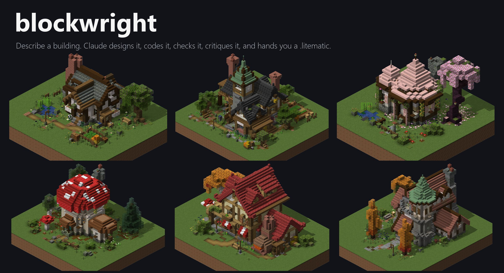</p>

blockwright is a **Claude Code plugin** plus a **Python toolkit** for handcrafted-quality Minecraft builds. You ask for
something like *"build me a medieval blacksmith as a litematic"*. Claude writes a brief, and a builder agent writes
a bespoke Python script for that one building. The toolkit turns the script into a game-accurate schematic and
checks it like a strict reviewer would. Then a fresh critic agent tears the result apart and prototypes the fixes,
and the builder applies them. You get a `.litematic` you can load in Litematica, a material list, and renders of
every side, every floor and the details.

Every build in this README came out of that loop, and every one passes QA with 0 errors and loads cell-for-cell
identical through Litematica's own reader.

---

## ✨ What makes it different

### 🎯 Game-accurate block states
Shapes that Minecraft computes from a block's neighbours have to be correct in the file, or Litematica's Schematic
Verifier and printer will fight you. blockwright resolves them exactly as the game does:
- stair corner shapes, fence, wall, pane and bar connections;
- leaf distances, vine faces, chest pairing, mushroom faces, door halves and more.

The rules were ported from the game's own code and then checked against the real game classes, headless:
- resolve matches the game's update logic on **194 fixtures (4,291 blocks)**;
- rotate and mirror match the game on all **35,723 block states**.

Typos fail loudly at the line that made them: `chain` → *"Did you mean: iron_chain?"*.

### 🔍 QA that catches what humans miss
`blockwright.qa` checks every build automatically:
- floating components and unsupported blocks (torches, plants, lanterns, carpets need a valid support);
- whether rooms are sealed or leak to the outside;
- **walkability**: a player-movement search from the front door to every room (door clearance, stairs, slabs);
- **spawn-proof lighting**: no block-light-0 spawnable cell inside;
- plants on valid soil, and contained water.

It also measures the design: footprint corners, ridge heights, flat wall runs and windows per facade.

### 🖼️ A real-texture renderer, in pure numpy
`blockwright.render` draws the actual vanilla block models and textures. It renders:
- isometric views from 4 sides and 4 elevations;
- a top view and per-floor **cutaways** that show the interior;
- an eye-level view and close-ups anywhere;
- a contact sheet that combines them.

It needs no GPU, no game and no mods, so the agents can *see* what they built and iterate on it.

### ✅ Litematica-native validation
`python -m blockwright validate` loads each file through **Litematica's own reader**, headless: the same code path as
the in-game "Load Schematic" button. It then compares the result cell by cell with an independent decode, and parses
every palette entry strictly against the live game registry.

### 🤖 The builder → critic loop
One agent builds, a *fresh* agent critiques, and the original builder applies the fixes while it still has its
context. The critic doesn't just complain: it prototypes its fixes in a scratch copy, keeps QA at 0, and proves them
with before/after renders.

<p align="center">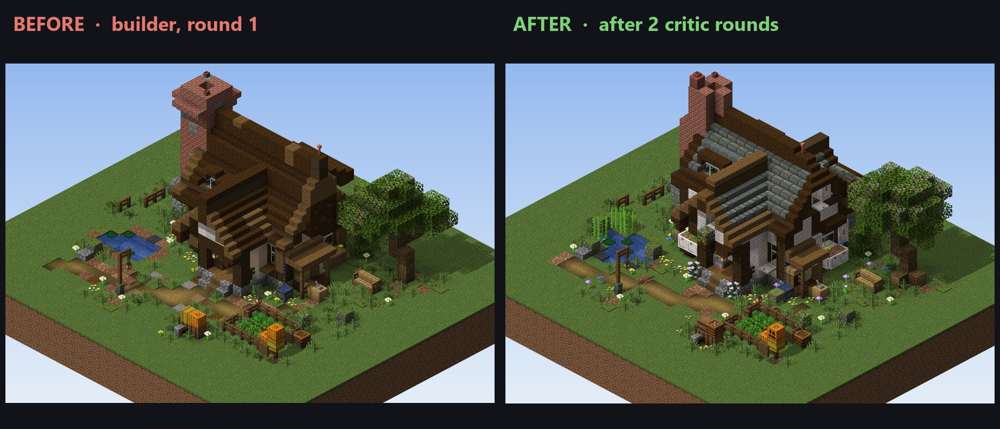</p>

### 🧱 "Only blocks I have"
Give it a palette file (`oak_planks`, `*_log`, `#minecraft:wool`, ...). QA then reports every item outside it as an
error, so the build is guaranteed to be buildable from your chests in survival.

### 🎨 Any style
The design knowledge comes in two layers:
- [universal lessons](docs/design/LESSONS.md): value contrast between roof and walls, no speckle noise, stair-on-stair
  roofs, chimneys, trees, composition, entrances, interiors and lighting;
- [style packs](docs/styles/), each a palette plus motifs plus anti-patterns: **cottagecore**, **medieval**,
  **fantasy**, **japanese**, **modern** and **rustic/survival**.

Writing your own pack takes a page.

---

## 🚀 Quick start

**1. Install the plugin** (in Claude Code):
```text
/plugin marketplace add JHVIW/blockwright
/plugin install blockwright@blockwright
```

**2. One-time setup** (Python 3.10+). It downloads the official Minecraft client jar from Mojang into your user cache
and extracts the textures for the renderer:
```bash
pip install "git+https://github.com/JHVIW/blockwright"   # numpy, pillow, nbtlib
python -m blockwright setup                              # add --java <JDK 25 home> for the optional validator
```
If you skip this, the skill does it for you: it runs `blockwright doctor` and installs from the plugin folder.

**3. Ask for a build:**
```text
> build me a medieval blacksmith as a litematic, about 20x16, only using the blocks in my_blocks.txt
```
The result lands in `out/schematics/`. Copy it into your instance's `schematics/` folder, or let Claude run
`python -m blockwright install-to "<your instance folder>"`.

### Without Claude: use the toolkit directly
```bash
mkdir my-builds && cd my-builds
python -m blockwright new blacksmith --style medieval      # scaffolds builds/blacksmith.py (a QA-clean starter)
python builds/blacksmith.py --quick                        # schematic + QA + materials + previews
python -m blockwright validate out/schematics/blacksmith.litematic
```

```python
from blockwright import *

b = Build("blacksmith", "The Anvil & Ember", ground=0)
spruce = wood("spruce")
b.fill(0, 0, 0, 8, 0, 6, "cobblestone")            # foundation in the ground layer
b.walls(0, 1, 0, 8, 3, 6, spruce.planks)           # hollow walls
front = b.frame((4, 1, 6), "south")                # facade-local coordinates
front.door(0, 0, 0, "spruce")
front.entrance(0, 0, 1)                            # QA starts its walk here
b.room("forge", 4, 1, 3)                           # QA checks it is sealed, reachable, lit
b.finish()                                         # resolve -> validate -> .litematic -> QA -> render
```

---

## 🖼️ Gallery

Six buildings from the example cottagecore set (three of the scripts ship in [`examples/builds/`](examples/builds)):

| | | |
|:-:|:-:|:-:|
| 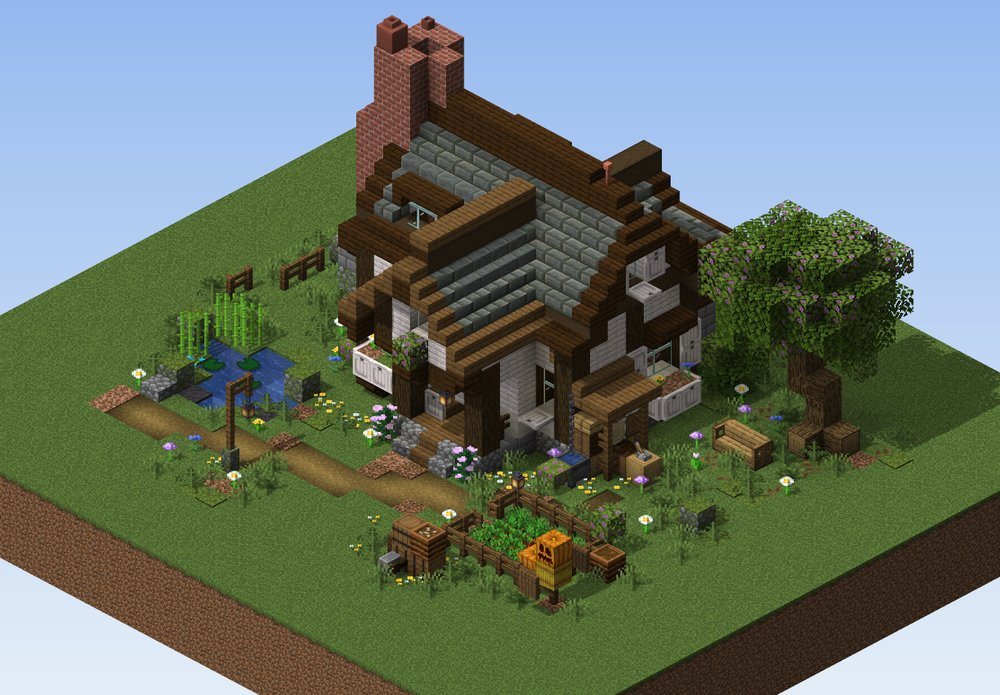<br>**Cozy Starter Cottage**<br><sub>catslide roof, tuff-slate field, jettied gable</sub> | 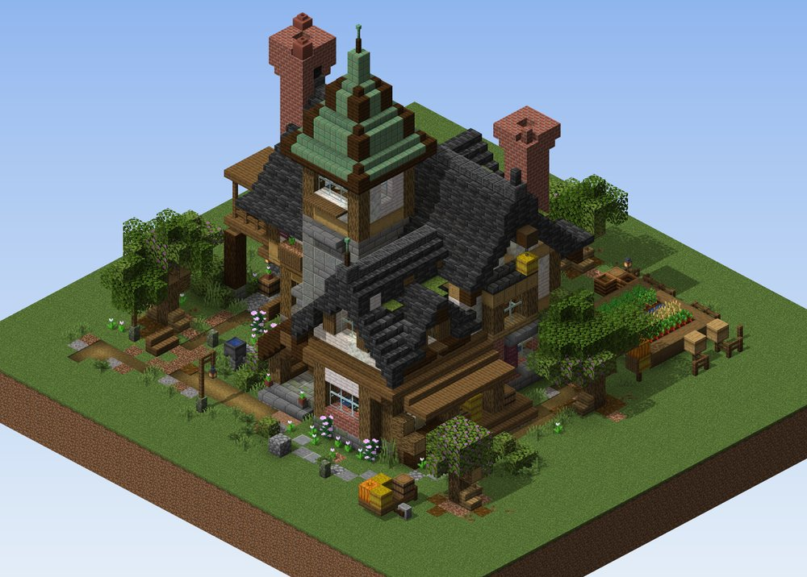<br>**Brambleworth Farmhouse**<br><sub>deepslate roof, copper-spired stair tower</sub> | 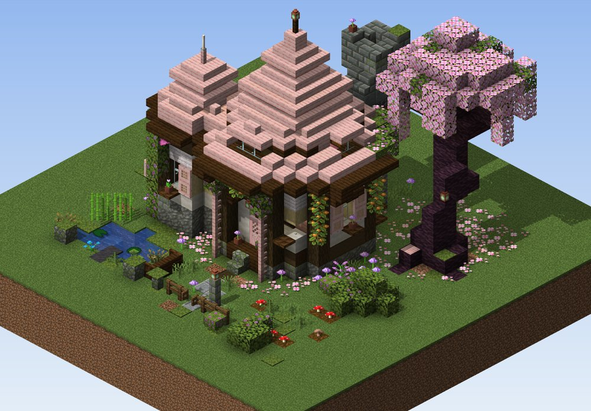<br>**Blossom Bell Cottage**<br><sub>cherry bell roofs, weeping cherry tree</sub> |
| 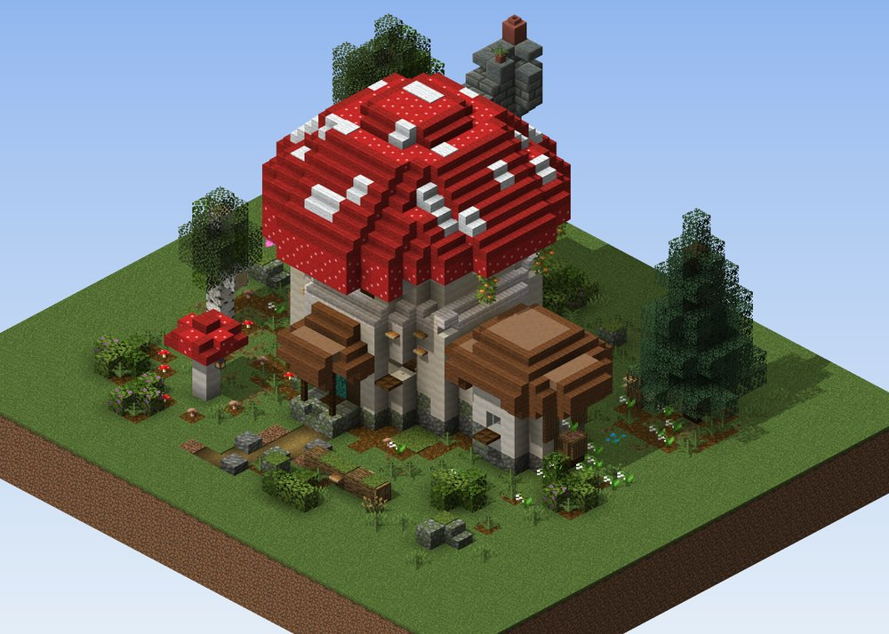<br>**Woodland Mushroom Cottage**<br><sub>a spotted cap over a calcite stem</sub> | 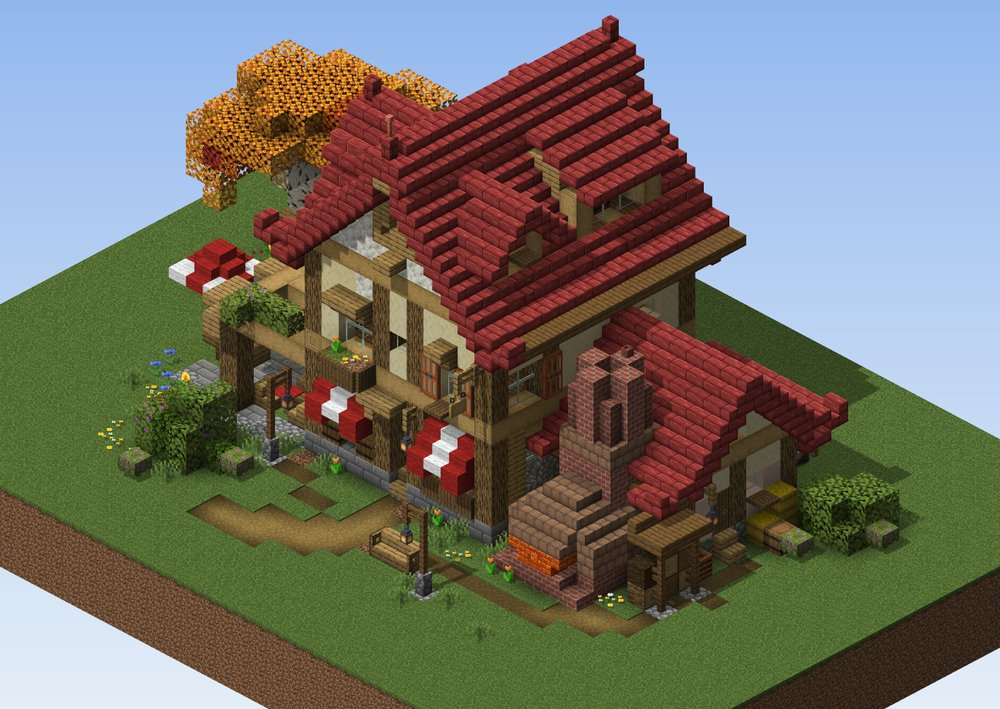<br>**Rustic Bakery**<br><sub>striped awnings, bread oven, timber frame</sub> | 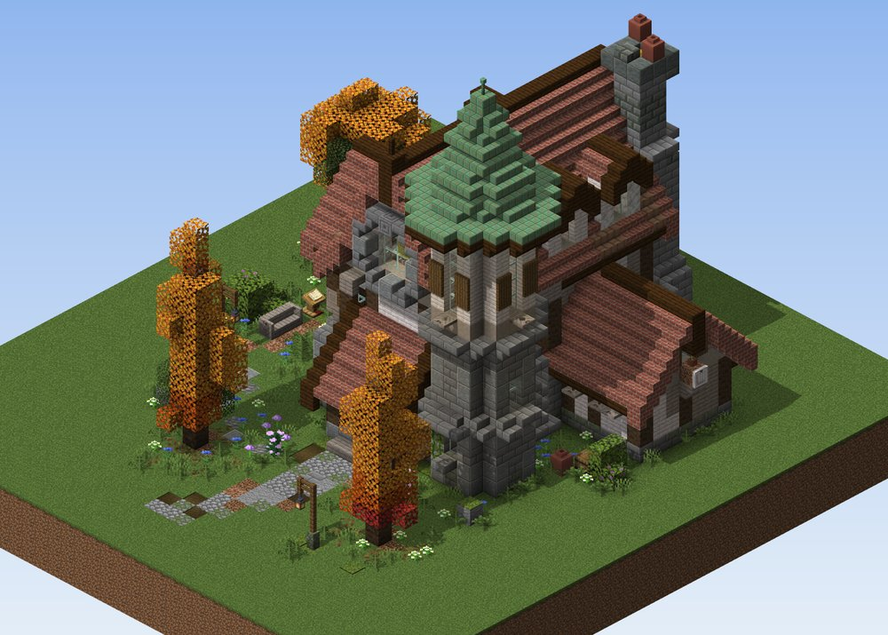<br>**Village Library**<br><sub>stone reading tower, autumn garden</sub> |

### Up close
Interiors are complete and furnished, and the details are real blocks:

| | | |
|:-:|:-:|:-:|
| 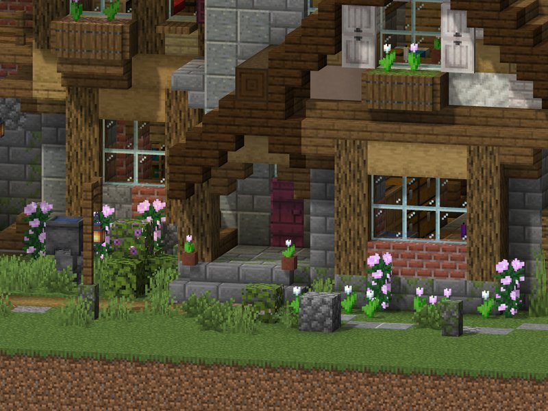<br><sub>porch, flower boxes, lantern</sub> | 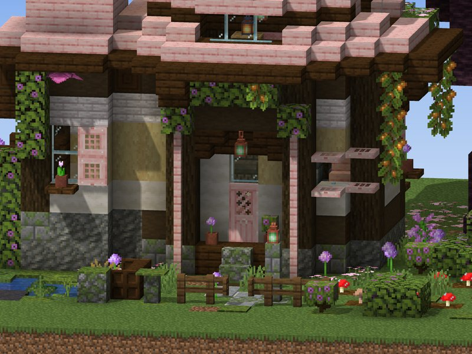<br><sub>an entrance you can't miss</sub> | 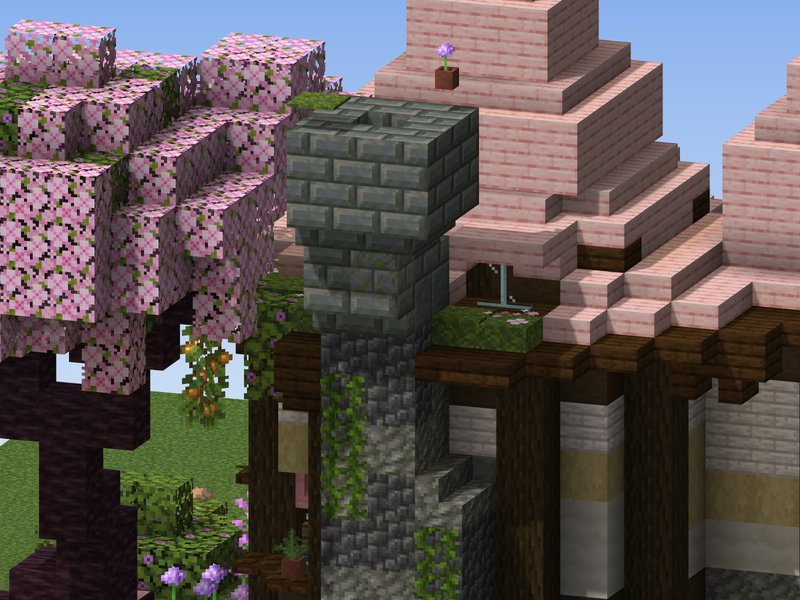<br><sub>a slim chimney that really smokes</sub> |
| 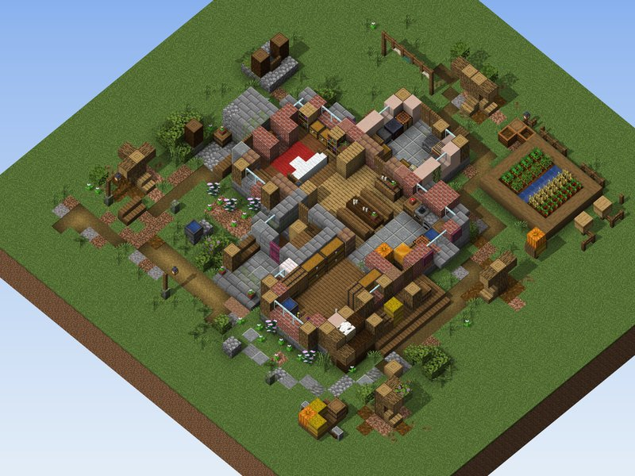<br><sub>floor cutaway: every room furnished</sub> | 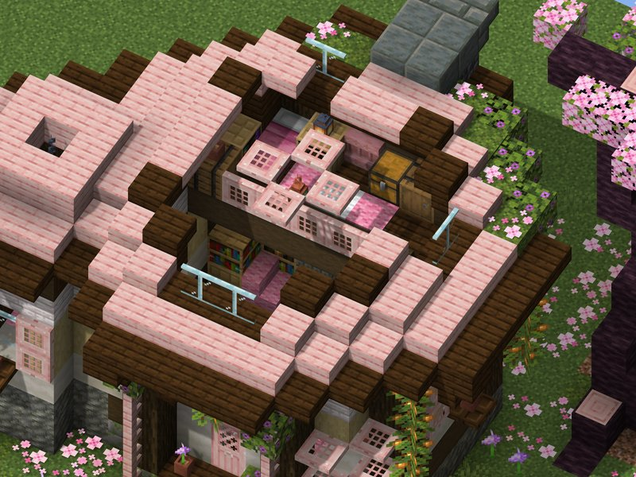<br><sub>loft bedroom under the bell roof</sub> | 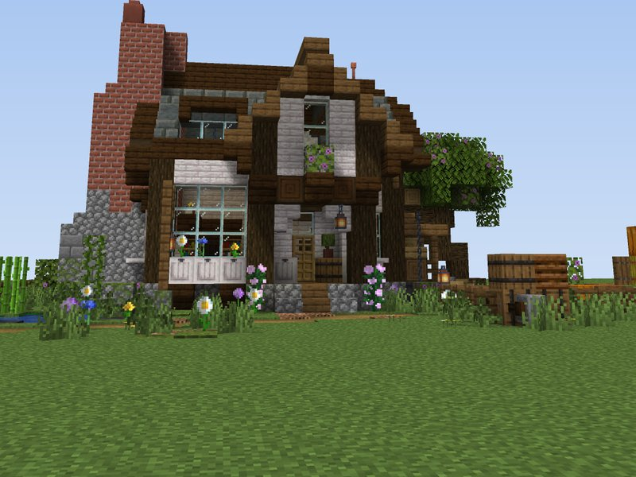<br><sub>eye-level view</sub> |

### The critic loop, in pictures
| Village Library | Brambleworth Farmhouse |
|:-:|:-:|
| 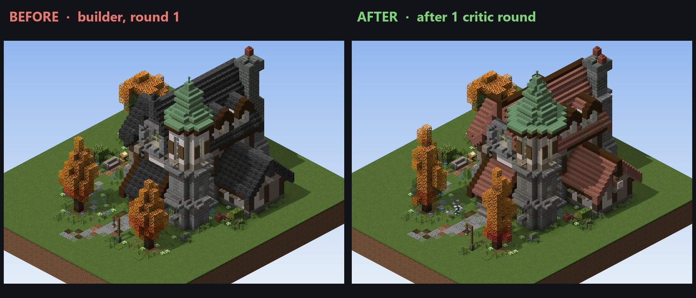 | 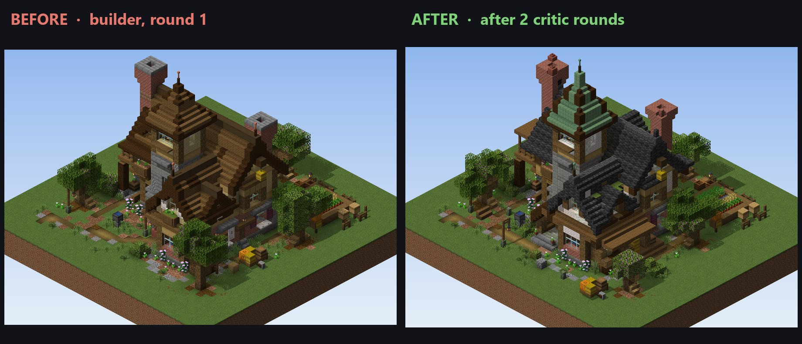 |

### What the agents see: a render sheet
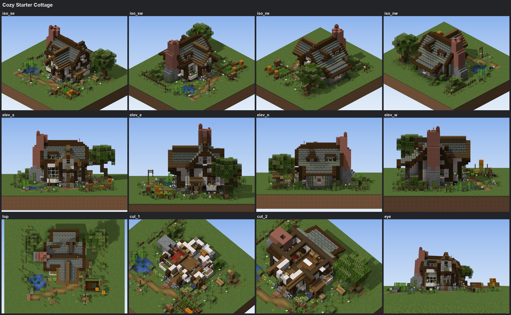

### What QA says
```text
# QA report - Cozy Starter Cottage
PASS - 0 error(s), 0 warning(s), 1 info
size (29, 17, 25), ground y=2, checked in 0.152s

floating    - ok   0 floating component(s)
support     - ok   312 blocks with survival rules checked, 0 failing; 0 uncontained fluid cell(s)
enclosure   - ok   living: sealed, kitchen: sealed, pantry: sealed, loft: sealed, bed_nook: sealed
walkability - ok   living: reachable, kitchen: reachable, pantry: reachable, loft: reachable, bed_nook: reachable
lighting    - ok   living: 0 spawnable, min light 5, kitchen: 0 spawnable, ...
metrics          footprint 147 cells, 24 convex / 20 concave corners; ridge heights [8, 11, 12, 13, 14]
                 longest flat wall run: 10 x dark_oak_planks; windows per facade: north 4, south 5, west 1, east 3
```

---

## 🛠️ How it works

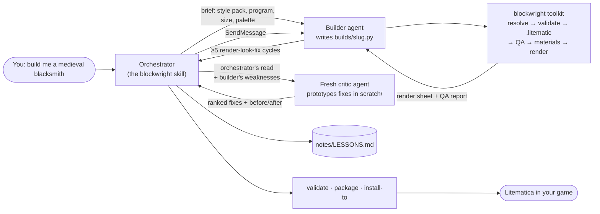

**The toolkit** (`blockwright/`):

| Module | What it does |
|---|---|
| `build.py` | `Build` (sparse voxel dict), `Frame` (facade-local coordinates), `paste` with rotate/mirror, and `finish()` |
| `registry.py` | every block, property and legal value of the game, from a registry dump; strict parsing with suggestions |
| `resolve.py` | derived states exactly as the game computes them |
| `litematic.py`, `structure_nbt.py` | Litematica writer/reader (format verified against the decompiled 0.29.1 jar) and vanilla structure `.nbt` |
| `qa.py` | the checks above, with every game rule ported from and cited to the game's code |
| `render/` | numpy software rasteriser for block models, textures, tints, light and shadows |
| `materials.py`, `palette.py` | survival material list (items, stacks) and the allowed-blocks constraint |
| `validator.py`, `java/` | Litematica-native validator and registry dump tools (Java, optional) |

**The workflow** (`skills/blockwright/`):
1. brief;
2. builder agent;
3. you look at the sheet;
4. fresh critic agent;
5. the builder applies the fixes;
6. lessons;
7. ship.

The skill also covers the operational rules: at most 3 concurrent agents, resuming stopped agents, scratch
prefixes, and never touching your game install.

### Setup details

`python -m blockwright setup`:
1. Downloads `version_manifest_v2.json` and the version JSON from **piston-meta.mojang.com**, then the **vanilla
   client jar**. SHA-1 is verified.
2. Extracts blockstates, block models and textures into your user cache:
   - Windows: `%LOCALAPPDATA%\blockwright\cache`;
   - macOS: `~/Library/Caches/blockwright`;
   - Linux: `~/.cache/blockwright`.
3. **Optional validator:** if a JDK 25+ is found (`--java`, the config, `JAVA_HOME` or `PATH`), it downloads:
   - the game's Java libraries (Mojang);
   - **Litematica** and **MaLiLib** (Modrinth API);
   - **fabric-loader** and ASM (Fabric maven).

   Then it compiles the validator. Without a JDK everything else still works.

Configuration lives in a small JSON file (`python -m blockwright doctor` shows where). You can override it per
workspace with `./blockwright.json`, or with environment variables:
- `BLOCKWRIGHT_CACHE`
- `BLOCKWRIGHT_JAVA_HOME`
- `BLOCKWRIGHT_MC_VERSION`
- `BLOCKWRIGHT_WORKSPACE`
- `BLOCKWRIGHT_PALETTE`

### CLI
| Command | |
|---|---|
| `python -m blockwright setup` | download the client jar and textures (and validator deps) |
| `python -m blockwright doctor` / `where` | show what's ready / print the docs and examples folders |
| `python -m blockwright new <slug> --style medieval [--palette f]` | scaffold `builds/<slug>.py` |
| `python -m blockwright build <slug> [--quick]` | run a build script |
| `python -m blockwright qa <file.litematic> [--allowed f]` | QA report → `out/reports/` |
| `python -m blockwright render <file.litematic> [dir] [--closeup X,Y,Z,r,az,el]` | previews |
| `python -m blockwright validate <file.litematic>...` | Litematica-native check |
| `python -m blockwright materials <file.litematic> [--allowed f]` | material list and palette check |
| `python -m blockwright package [slugs] --name <set>` | zip schematics, previews and materials into `dist/` |
| `python -m blockwright install-to <minecraft folder> [--folder <set>]` | copy into `<folder>/schematics/` |
| `python -m blockwright dump-registry` | regenerate the registry data from the game (JDK) |

---

## ⚠️ Limitations

- **Tested on Minecraft Java 26.3 + Litematica 0.29.1.** The version is configurable (`--mc-version`), and
  `dump-registry` regenerates the block data from any version's jar. The ported game rules (QA, resolve) and the
  Litematica format are only verified for the tested combination.
- **Block states only.** Signs carry no text, banners no patterns, and there are no entities (item frames, armour
  stands, mobs).
- **Not a one-click generator.** Quality comes from the agent loop. A full build with 2 critic rounds takes a while
  and uses a fair amount of tokens. Quick mode (no critic) is faster but plainer.
- **The renderer is a preview.** It is close to the game (real models, textures, tints, light), but it is not the
  game's shader pipeline. Animated textures show their first frame.
- **Terrain.** Schematics never carve terrain: cells left empty keep your world's ground. Paste with Replace =
  "With non-air" and flatten the site first.
- The validator needs a JDK 25+. The renderer and QA need only Python.

## ❓ FAQ

**Do I need Minecraft installed?** No. `setup` downloads the client jar from Mojang's servers for the textures. To
*use* the schematics you need Minecraft Java with Fabric + Litematica, of course.

**Does it ship any Mojang assets?** No. The repo contains only code, factual registry data (block ids, properties,
shapes, tag membership) and renders. Textures are downloaded to your machine by `setup`, from Mojang.

**Can I use it without Claude?** Yes. It is a normal Python library and CLI. Write the build scripts yourself; the
docs in [`docs/`](docs/) are the same ones the agents read.

**Survival-friendly?** Every build gets a material list in items and stacks. With an allowed-blocks file, QA
guarantees that you own every block in it. Derived states are stored exactly as the game computes them, so
Litematica's verifier and printers show no false mismatches.

**Which styles work?** Anything you can describe. The six packs are starting points: the builder uses the closest
one, or Claude writes a quick custom pack for something new (steampunk, desert, elven, ...).

**Other Minecraft versions?** Run `python -m blockwright setup --mc-version <v>`, then `dump-registry`. Expect to
re-verify the edge cases. Pull requests for new versions are welcome.

**Why Python scripts instead of a model that outputs blocks?** Scripts are reviewable and diffable, and they can
be edited by a critic. Techniques such as roof functions, tree recipes and gradients carry over from build to
build, and every result is deterministic.

## 🤝 Contributing

Issues and PRs are welcome: new style packs, lessons, QA rules and renderer fixes. See
[CONTRIBUTING.md](CONTRIBUTING.md). The test suite runs without any Minecraft files:
`pip install -e .[dev] && pytest`.

## 📜 License and legal

MIT © JHVIW. See [LICENSE](LICENSE).

**Not an official Minecraft product.** This project is not approved by or associated with Mojang or Microsoft.
Minecraft is a trademark of Mojang AB. The repository contains no Mojang code or assets. Litematica and MaLiLib
are by masa and are downloaded from Modrinth only to run the optional validator on your machine.
